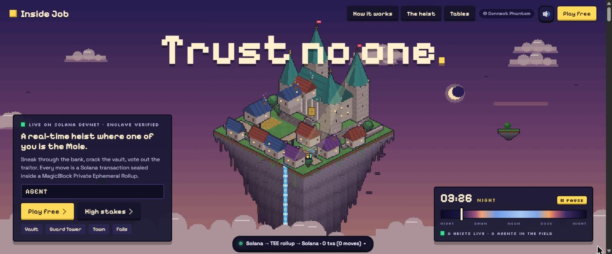
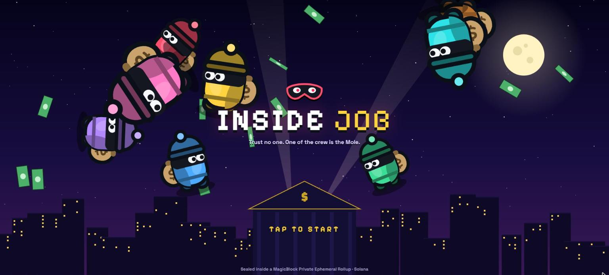
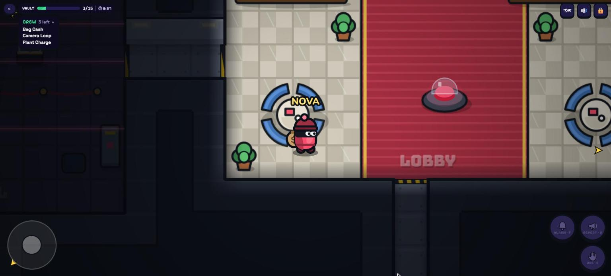
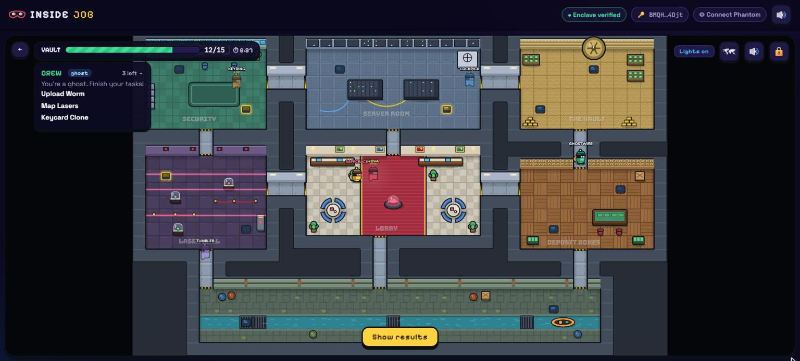
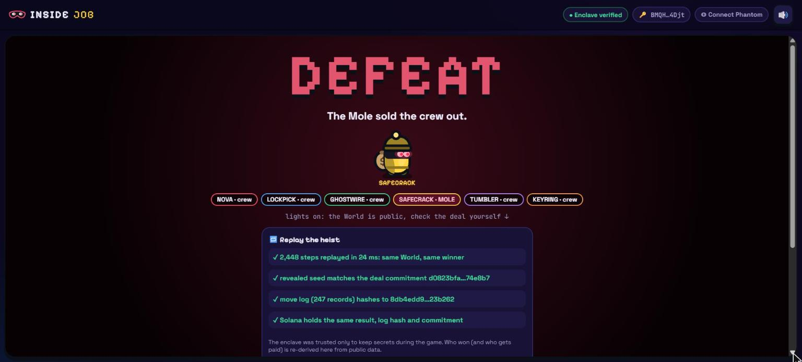
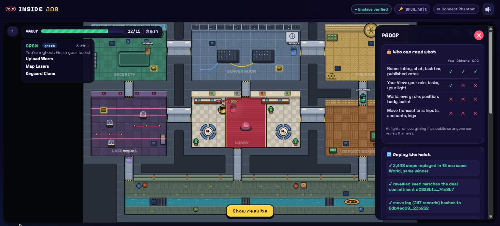
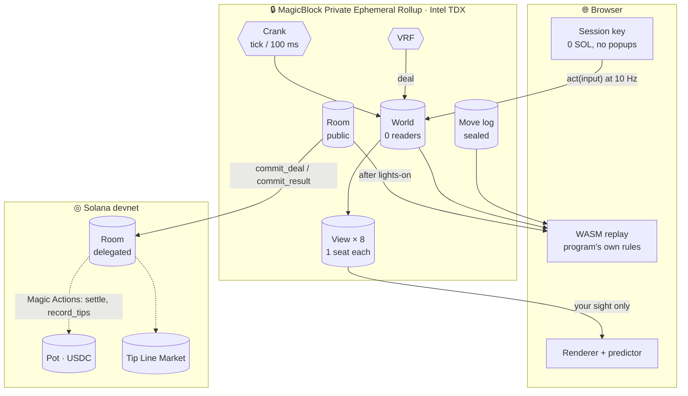

<div align="center">

# 🎭 INSIDE JOB

**A real-time heist of social deduction where nobody can know the Mole —<br>not the players, not the chain, not even the randomness oracle.**

[](https://inside-job-six.vercel.app)


Built for **MagicBlock Solana Blitz v10 — Entertainment Finance**

[Play](https://inside-job-six.vercel.app) · [How it works](#how-it-works) · [Trust model](#trust-the-enclave-for-secrets-not-for-the-result) · [Live proof](docs/E2E_DEVNET.md) · [Run it](#getting-started)



</div>

---

Every move, cuff and sealed vote is a gasless Solana transaction inside a **MagicBlock
Private Ephemeral Rollup** running on Intel TDX. A crank ticks the game every 100 ms inside
the enclave. **There is no game server.** When the heist ends the lights come on: the sealed
state flips public and your browser replays the entire heist with the program's own rules
to prove the result.

## Contents

- [Screenshots](#screenshots)
- [Why it can't exist on plain Solana](#why-it-cant-exist-on-plain-solana)
- [The game](#the-game)
- [How it works](#how-it-works)
- [Trust the enclave for secrets, not for the result](#trust-the-enclave-for-secrets-not-for-the-result)
- [Privacy: who can read what](#privacy-who-can-read-what)
- [Money: staked tables and the Tip Line](#money-staked-tables-and-the-tip-line)
- [MagicBlock building blocks](#magicblock-building-blocks)
- [Security review](#security-review)
- [Getting started](#getting-started)
- [Project structure](#project-structure)
- [Deployment](#deployment)
- [Known limits](#known-limits)

## Screenshots

<table>
<tr>
<td width="50%"><br><sub><b>Phone build.</b> Opens on an intro, then a game menu; the whole app plays in landscape.</sub></td>
<td width="50%"><br><sub><b>The heist.</b> Joystick left, actions right. You see only what your light reveals, computed inside the TEE.</sub></td>
</tr>
<tr>
<td width="50%"><br><sub><b>Lights on.</b> The sealed World flips public: every robber's true position and role.</sub></td>
<td width="50%"><br><sub><b>Verify it yourself.</b> 2,448 steps replayed in the browser; seed, move log and Solana's copy all match.</sub></td>
</tr>
<tr>
<td colspan="2"><br><sub><b>The 🔒 proof drawer.</b> Who can read what, the replay check, and a "try to cheat" console that asks the TEE for sealed accounts live.</sub></td>
</tr>
</table>

## Why it can't exist on plain Solana

On a public chain every account is readable. A hidden-role game there is over before it
starts: the Mole is one `getAccountInfo` away, and so is everyone's position — which is just
as revealing (*who was standing next to the body?*).

INSIDE JOB keeps **roles, true positions, bodies, ballots and salts** in a `World` account
whose permission has **zero members**. Each seat can read only its own `View`: what its
light reveals, computed inside the TEE every tick.

## The game

A crew of robbers cracks a vault in real time. One of them (two at 7–8 players) is an
undercover **Mole**.

| | Desktop | Phone |
|---|---|---|
| Move | `WASD` / arrows | joystick |
| **Crew:** work your three stations; fill the vault bar to win | `E` | USE |
| **Mole:** cuff crew when nobody's looking, fake your tasks | `Q` | CUFF |
| Report a body → meeting | `R` | REPORT |
| Emergency button in the lobby → meeting | `F` | ALARM |
| Map | `M` | 🗺 |

- **Meetings:** chat is on-chain (lobby, meetings, after the game; nobody talks mid-heist). **Ballots are sealed** in the World and published all at once at the tally.
- **Time lock:** if the crew hasn't cracked the vault in 9 minutes, the alarm wins it for the Mole.
- **Lights on:** when the game ends, World and every View flip public. Anyone can replay the deal and check every role.
- **Bots:** empty seats become on-chain bots that obey the same fog of war.

**On a phone** the app is a landscape game from launch: intro → menu → lobby → heist.
Android goes fullscreen and locks landscape; where that isn't possible (iPhone, or a phone
locked to portrait) the app rotates itself and the joystick input is rotated to match.

**Moving feels instant even though the truth is sealed.** Your position lives in the World,
so the server's answer always arrives a round trip late. The client runs the program's own
integer movement rule at the measured crank rate ([`predict.ts`](app/src/game/predict.ts)),
draws between ticks, and reconciles by matching the server's report against where *you*
were when it was computed, so a lagging server never drags you backwards. Moves reuse a
cached rollup blockhash, so each 100 ms `act` is a single request.

## How it works



**A heist, end to end**

1. **Lobby.** `join` seats your session key and writes your secret salt straight into the sealed World.
2. **Deal.** `start_match` requests VRF and schedules the crank. The VRF callback deals roles from `SHA-256(VRF ‖ every seat's salt ‖ room ‖ heist)`, so the oracle can't know the Mole.
3. **Commit the deal.** `commit_deal` pushes the Room, carrying a hash commitment to the seed, to Solana while the seed is still sealed.
4. **Play.** Each client sends one uniform `act` every 100 ms. The crank's `tick` runs movement, vision, cooldowns, meetings and bots, logs every external input, and writes each seat's View.
5. **Lights on.** `finish` flips the World, Views and move log public.
6. **Commit the result.** `commit_result` commits the final Room to Solana, with Magic Actions that settle the Pot and resolve the Tip Line there.
7. **Verify.** The browser replays every step in WASM and checks it against what Solana holds.

## Trust the enclave for secrets, not for the result

A TEE keeps the Mole hidden *during* the heist. It should not also be the judge, so nothing
it decides has to be taken on faith:

1. **Deal commitment, on Solana before play.** At the deal the Room stores `H("inside-job/commit/v1" ‖ seed ‖ room ‖ heist)`, and `commit_deal` pushes it to Solana while the seed is still sealed. Roles can't be re-dealt mid-game.
2. **A move log with a hash chain.** Every tick, [`replaylog.rs`](programs/inside-job/src/replaylog.rs) records everything the rules take from outside — each human's input, each ballot, the clock — into a sealed log account and folds it into a SHA-256 chain the Room carries. Bots aren't logged: they're part of the rules.
3. **Every result is committed.** After lights-on, `commit_result` (permissionless, once per heist) commits the final Room — winner, roles, deal commitment, log hash — to Solana, free tables too.
4. **The browser replays the heist.** [`tools/replay`](tools/replay) compiles the program's *own* `state.rs` + `sim.rs` + `replaylog.rs` to WebAssembly (75 KB). The client replays every step from the deal and checks: same World byte-for-byte, same winner, seed matches the commitment, log matches the hash Solana holds.

**Why not a ZK proof?** A 10 Hz real-time game is thousands of simulation steps per heist;
proving that fast enough to matter isn't practical today. Once lights-on makes everything
public, deterministic replay gives anyone the same guarantee — the outcome follows from the
committed inputs — without a trusted setup. Tests replay 16 random heists exactly (humans
mashing inputs, meetings, ballots, a 70-minute clock jump); a doctored move, seed, role or
winner is always caught.

**What the TEE is still trusted for:** keeping roles, positions and inputs secret until
lights-on, and not inventing inputs for a human (the log binds the result to *some* input
sequence; the inputs themselves were private while the game ran).

## Privacy: who can read what

| | You | Other players | Spectators / RPC | After lights-on |
|---|:-:|:-:|:-:|:-:|
| Room: lobby, chat, alive-at-last-meeting, task bar, published votes | ✓ | ✓ | ✓ | ✓ |
| Your View: your role, tasks, what your light reveals | ✓ | ✕ | ✕ | ✓ |
| World: every role, position, body, ballot, salt | ✕ | ✕ | ✕ | ✓ |
| Pot (Solana): tickets, stakes, payouts | ✓ | ✓ | ✓ | ✓ |
| Gameplay transactions (`act` inputs, accounts, logs) | ✕ | ✕ | ✕ | ✕ |

**Hiding the role field is not enough.** Every side channel that would give the Mole away:

| Leak | Fix |
|---|---|
| Role stored in an account | World has zero readers |
| Positions (who was near the body) | Only in World; Views are derived inside the TEE |
| Kills | A body appears only in Views that can see it; the Room learns of deaths only at a meeting |
| Per-player task counts (the Mole never completes any) | Room shows only the crew-wide bar |
| Instruction type (`cuff` vs `move`) | **One** `act(input, seq)` instruction for move / work / cuff / report / emergency |
| Input timing (the Mole goes quiet, then strikes) | The client sends `act` at a constant 10 Hz, no-ops included |
| Transaction bodies (`act`'s input byte carries the cuff bit) | The TEE RPC answers `getTransaction` with a redacted shell (signature, slot, time; 0 accounts, 0 instructions, 0 logs) for everyone, signer included; `getSignaturesForAddress` on World or a View lists nothing. Checked live by `e2e.ts` and the in-game console |
| The VRF oracle knows the randomness | Roles = SHA-256(VRF ‖ all sealed salts ‖ room ‖ heist), computed in the TEE |
| Logs | The program never logs game state |
| Vote order / bandwagoning | Ballots sealed in the World, published together at the tally |

**What keeps it fair**

- **Unsteerable deal:** each player's 32-byte salt is written straight into the sealed World at `join` (and refreshed every heist); the oracle never sees the salts, and players never see the VRF output in time.
- **Verifiable afterwards:** the client recomputes `seed = SHA-256("inside-job/deal/v1" ‖ vrf ‖ salts ‖ room_id ‖ match_no)` and replays the program's exact shuffle (splitmix64 + rejection sampling + Fisher-Yates).
- **Oracle down?** After ~6 s any seated player may deal from rollup state (still salted), flagged `fallback` in the UI.
- **Liveness:** if the crank stalls, any client may call `tick`. It's slot-gated on chain (at most one tick per 8 rollup slots, ~80 ms), so extra callers can speed the game up by at most ~25%, never skip or replay a step.
- **Deterministic rules, tested:** [`sim.rs`](programs/inside-job/src/sim.rs) is pure functions with unit tests (deal distribution, walls, per-room vision, cuffs + witnesses, meetings, ties, ghosts, a 40-game bot balance run).

## Money: staked tables and the Tip Line

### Staked tables: a pot that pays itself out

1. **Ticket (Solana).** `buy_ticket` moves the table's stake (devnet USDC) from your wallet into that heist's `Pot` and names the in-browser **session key** that may use the ticket. The Pot is plain base-layer state; the money never leaves Solana.
2. **Seat (TEE).** `join` reads the Pot from Solana inside the rollup and seats only the session key the ticket named. A different key with the same wallet is refused.
3. **Lights on → payout.** `commit_result` commits the Room to Solana with a post-commit **Magic Action** that runs `settle` there. `settle` reads the *committed* Room (winner + published roles) and pays the winning humans. **No oracle, no admin.**
4. **Failure paths.** `settle` is permissionless and idempotent, so anyone can run the same payout from the committed Room if the action never lands. A pot still open after 20 minutes can be **refunded by anyone** — never re-rolled. A refund can't cut a heist short: while Solana's copy of the Room shows the heist running, the 20 minutes count from its start, and once it shows a result the pot must be settled instead.

**The rules** ([`money.rs`](programs/inside-job/src/money.rs)): seated humans on the winning
team split everything the seated humans staked; tickets that never sat down are refunded;
if no human won (bots did), every human is refunded; no house cut. A property test sweeps
every ticket count, stake, seating and winner and asserts **payouts == stake × tickets**.

### Tip Line: a prediction market with no oracle

Spectators stake devnet USDC on **who the Mole is**. The stake goes to a `Market` PDA's token
account on Solana (`buy_tip`, 0.1–5 USDC, one entry per wallet per heist). The *call* is made
inside the rollup (`pick`, signed by the session key the tip named) and lands in the public
Room with a weight = heist time left, so calling early pays more. Seated players are refused,
dead seats can't be picked, and calls close when the heist ends.

After lights-on, `commit_result` carries a second Magic Action, `record_tips`, that copies every
call plus the published roles into the Market. Right calls get their stake back plus a share
of the wrong calls' stakes in proportion to stake × weight; if nobody called a Mole, everyone
is refunded; no house cut. Payouts are claimed with `claim_tip` (permissionless, only in the
room's own mint). An unresolved Tip Line refunds everyone after 20 minutes.

## MagicBlock building blocks

Take one away and the game breaks:

| Building block | Job in INSIDE JOB |
|---|---|
| **Private Ephemeral Rollup (TEE)** | Holds the sealed truth. Without it, roles and positions are public state. |
| **Ephemeral permissions** | `World` has 0 readers · `View[i]` is readable only by seat *i*'s session key + wallet · `Room` is public. `join`/`leave` rewrite View members, `finish` flips everything public, `reset` re-seals. |
| **Ephemeral accounts** | World, the 8 Views and the move log live only inside the rollup, rent sponsored by the Room PDA. |
| **VRF** (delegated queue) | Seeds the deal. Mixed with every player's sealed salt so the oracle can't know the roles. |
| **Crank** | `start_match` schedules `tick` every 100 ms: movement, vision, cooldowns, meetings, bots. |
| **Session keys** | The browser makes a key with 0 SOL that signs ~10 moves/s, with no wallet popups, and can't move funds. |
| **Delegation** | Room PDAs live on Solana and are delegated to the TEE validator only. |
| **Commits** | The deal commitment before play, and the final Room after lights-on: the only things Solana learns about a heist. |
| **Magic Actions** | The result commit carries `settle` and `record_tips`, so lights-on *is* the payout. |

**Small binary.** [`magic.rs`](programs/inside-job/src/magic.rs) encodes the one
`ScheduleIntentBundle` the program needs by hand (the SDK builder adds ~130 KB of bincode); a
test asserts it is byte-for-byte what the SDK produces.

## Security review

Before submission the program was checked against the
[solanabr/auditor-skill](https://github.com/solanabr/auditor-skill) checklists (account
validation, access control, arithmetic, CPI/PDA, state machine, economic attacks) and the
rollup rules in [MagicBlock's dev skill](https://docs.magicblock.gg/pages/overview/additional-information/ai-dev-skill)
(VRF callback identity, crank callers, delegation is not authorization, commit limits).
Three issues were found and fixed:

| Severity | Issue | Fix |
|---|---|---|
| High | `claim_tip` is permissionless and never bound the mint: anyone could "pay" a Tip Line entry in a junk token parked in the Market's account for it, set its claimed bit and void the real USDC payout | `claim_tip` takes the Room and requires `mint == room.mint` |
| High (liveness) | The rollup refuses plain commits after 10 per delegation. The commit ran inside `finish`, so a refused commit reverted lights-on and stranded the room | The commit + Magic Actions moved to a separate `commit_result`; a refused commit can no longer touch the game |
| Medium | Refund timers started at the first ticket / tip, so after a long lobby they could expire mid-heist and a losing player could void the pot or the Tip Line | While Solana's copy of the Room shows the heist running, the window counts from its start; once it shows a result, the pot must be settled |

Passing as-is: every PDA re-derived, mint and Token program owners pinned, payouts only to
derived ATAs, `transfer_checked`, the VRF callback behind `#[vrf_callback]` with duplicate
callbacks ignored, delegation pinned to the TEE validator.

## Getting started

**Prerequisites:** Node 20+, and for the program: WSL/Linux with Rust 1.89, Solana CLI 3.1.x, Anchor 1.0.x.

```bash
# web client
cd app && npm install
npm run dev                              # http://localhost:5173 — add ?touch=1 for the phone layout
```

```bash
# program (WSL / Linux)
bash scripts/test.sh                     # 29 unit tests: rules, payouts, replay, refunds, commit encoding
bash scripts/build.sh                    # SBF build + IDL (copied to app/src/idl)
bash scripts/upgrade.sh                  # upgrade the devnet program (extends the account if it grew)
                                         # then wait ~1 min: the rollup runs the old binary briefly

# provision + test against the live devnet TEE
cd app
npx tsx scripts/setup-rooms.ts           # free crews 31-34 + staked tables 41:1 42:1 (USDC a seat)
npx tsx scripts/e2e.ts 31                # a full heist: privacy, VRF, commits, replay
npx tsx scripts/e2e-stake.ts 41          # money path; needs 3 devnet USDC in the admin wallet
```

## Project structure

```
programs/inside-job/src/
  lib.rs           instructions + account contexts
  sim.rs           the game rules (pure, unit-tested)
  money.rs         payout rules (pure, conservation-tested)
  replaylog.rs     move log, hash chain, deal commitment
  magic.rs         hand-encoded commit + Magic Action intent (tested against the SDK)
  state.rs         zero-copy Room / World / View / Pot / Market layouts
  map.txt          the map, read by the program (build.rs) AND the web client
  stations.txt     task stations, same
tools/
  replay/          the program's own rules compiled to WASM for in-browser replay
  idlgen/          IDL builder (avoids anchor-cli switching the Solana toolchain)
app/src/
  chain/           session key, TEE auth, instructions, decoders, verification
  game/            canvas renderer, map art, movement prediction, sound
  ui/              phone intro + menu, lobby, heist, meeting, lights-on, proof, Tip Line
app/scripts/       setup-rooms, e2e (live TEE), e2e-stake (money path)
scripts/           WSL build / test / deploy helpers
docs/              live devnet proof, screenshots
```

## Deployment

| | |
|---|---|
| Web app | **https://inside-job-six.vercel.app** (Vercel, deploys from `main`) |
| Program (devnet) | [`9B5TZmBnskcBrZ1QMCuojqrDEn1dEsb3oVNtgvZ73R2U`](https://explorer.solana.com/address/9B5TZmBnskcBrZ1QMCuojqrDEn1dEsb3oVNtgvZ73R2U?cluster=devnet) |
| Rollup | MagicBlock TEE devnet `devnet-tee.magicblock.app`, validator `MTEWGuqxUpYZGFJQcp8tLN7x5v9BSeoFHYWQQ3n3xzo` |
| Free tables | crews 31–34, no wallet needed |
| Staked tables | 41–42, 1 devnet USDC a seat |
| Live proof | [docs/E2E_DEVNET.md](docs/E2E_DEVNET.md): every check passing against the live TEE |

## Known limits

- **The TEE is the trust anchor for privacy, not for the result.** Secrecy during the game rests on MagicBlock's Intel TDX validator and its permission checks; the client checks the enclave's attestation with `verifyTeeRpcIntegrity`. The outcome is re-derived in the browser from the committed deal and the move log.
- **Devnet only.** Stakes and tips are devnet USDC (Circle's faucet). Mainnet would need real-money compliance work first.
- **Commit budget.** Each heist uses two commits, and the rollup allows 10 plain commits per delegation, so a room gets about 5 committed heists before it must be re-delegated (or pay for commits from a MagicBlock fee vault, not built yet). Past that the game still plays and replays, but results stop reaching Solana, so staked pots fall back to refunds.
- **Insiders.** A player can't tip on their own crew from their seat's keys, but nothing stops a second wallet; tips are capped at 5 USDC.
- **Who sat where is public** on staked tables (the Pot lists wallets, the Room lists seats); roles stay sealed until lights-on.
- Players talking over voice can always collude, as in every online social-deduction game.

<div align="center"><sub>Original art and code. Built for MagicBlock Solana Blitz v10.</sub></div>
